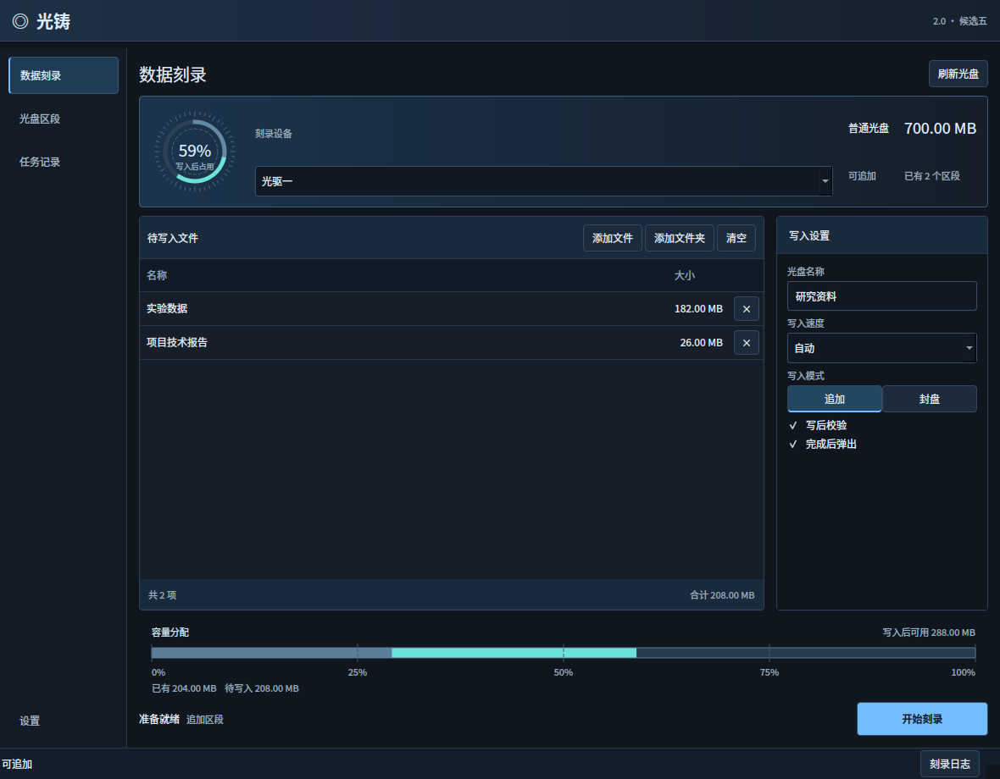
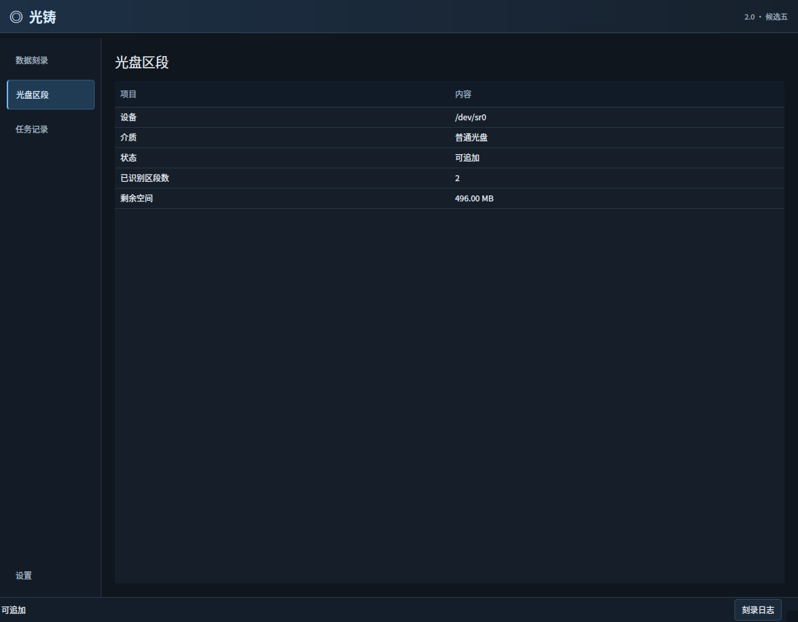
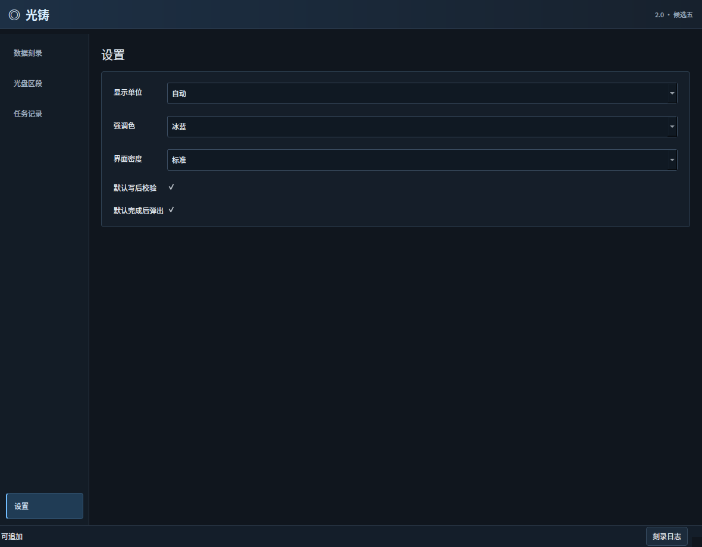

# 光铸 · DiscForge

一个轻量的 Linux 数据光盘刻录器。使用 C++17 和 Qt6 原生界面，支持 CD、DVD 与多区段追加，提供中文工作区、容量图表和文件校验。

**当前版本：2.0.0-rc5，候选测试版。** 已收到 CD 追加后在 Ubuntu 正常打开新旧文件的实盘反馈；Windows 读取尚未测试。本版新增的直接扇区校验已通过模拟多区段测试，仍待实盘验证。



## 可以做什么

- 导入文件、文件夹或直接拖入，自动读取光盘类型、容量及可追加状态。
- 首次刻录、继续追加或写入后封盘；支持自动或指定速度。
- 写入前缓存源文件，检查剩余容量、重名和文件名兼容性。
- 写入后重新读取原有文件和新增文件，核对 SHA-256。
- 显示当前阶段、真实写入进度、用时和日志；保留最近 200 次任务记录。
- 设置容量单位、强调色、界面密度、默认校验和自动弹出。

程序使用系统 Qt 动态库和刻录工具，不捆绑浏览器或 Python 运行时。deb 本体约百余 KB；新系统的依赖下载另计。应用本身不联网。

## 安装

安装包由 **GitHub Actions 云端编译**，按 Ubuntu 22.04、24.04、26.04 和 amd64、arm64 分别构建。每个环境独立使用系统 Qt，测试通过并完成安装检查后才发布。

[下载 Release](https://github.com/lbg2002/DiscForge/releases) · [查看云端构建](https://github.com/lbg2002/DiscForge/actions)

请匹配系统版本和处理器架构；不要把新系统构建的 deb 安装到旧系统。其他发行版尚未验证。

下载对应的 deb，或按下文自行构建后安装：

```bash
sudo apt install ./discforge_2.0.0~rc5+ubuntu24.04_amd64.deb
```

在应用菜单打开“光铸”，也可以运行：

```bash
discforge-native
```

卸载：

```bash
sudo apt remove discforge
```

## 使用

1. 插入光盘，点击“刷新光盘”，确认状态与剩余容量。
2. 添加文件或文件夹，填写光盘名称。
3. 选择追加或封盘、速度、校验和弹出选项，开始刻录。
4. 等待写入及区段关闭完成，再查看校验结果。

追加时，新加入的顶层文件或文件夹不能与光盘已有项目重名。目前不合并已有同名文件夹，请使用新的文件夹名。不提供擦除、格式化、音频 CD 或启动盘制作功能。

### 光盘区段

展示光驱返回的介质状态、区段数量和容量。图表表示已用、计划写入与剩余容量，不是逐区段文件历史。



### 设置

容量单位支持自动、KB、MB、GB，按 1024 进制换算，并应用于列表、容量图表和任务记录。



以上截图由实际程序在自检模式下渲染，文件与介质数据为演示数据。

## 本版修复

**CD 写后校验不再依赖立即挂载。** 部分光驱刻录结束后，Ubuntu 尚未识别文件系统，程序即使反复请求挂载也会失败；重新插入后却能正常读取。此前这会导致“数据写入完成，校验未完成”。

本版以只读方式向光驱发送 READ(10)，从本次写入的实际区段起点读取 Joliet 中文目录，核对全部原有及新增文件的 SHA-256。目录与文件位置使用绝对扇区地址，不会误把旧区段当作最新目录。该路径不需要挂载，不提升权限，也不改变刻录参数；无法读取或内容不一致时仍明确报告校验未完成。

写入、校验和弹出分别记录。选中自动弹出后，即使校验未完成，也会尝试弹出；不会因此自动重新刻录。无盘或托盘打开时显示对应状态，未知介质则保留工具诊断日志。

同时拦截会被 Joliet 改名的分号、超出 UCS-2 的字符，以及 Windows 保留名、非法字符、大小写重名和符号链接，避免写盘后才发现目录名称不一致。

DVD 保持原有 `growisofs` 写入与挂载后校验流程。

## 底层实现

| 部分 | 实现 |
|---|---|
| 界面 | C++17、Qt6 Widgets、QtConcurrent |
| CD 映像 | `genisoimage`，ISO 9660 + Joliet + Rock Ridge |
| CD 写入 | `wodim`，TAO；追加保留 `-multi` |
| DVD 写入 | `growisofs`，首次 `-Z`、追加 `-M` |
| CD 校验 | 只读 SG_IO READ(10)、Joliet 目录解析、SHA-256 |
| 设备与挂载 | UDisks2、系统光驱接口 |

CD 追加通过 `-C/-M` 导入原有目录，生成独立映像文件，再交给 wodim。映像与诊断输出分开，避免日志混入数据流。

仅对 wodim 子进程禁用可选的内存锁定，并显式限制 FIFO，处理有限锁页额度下的内存分配失败。父程序与系统限制保持原样；日志中的 RLIMIT_MEMLOCK 警告本身不代表刻录失败。技术记录见 [锁页修复](docs/锁页修复.md)。

## 测试状态

| 项目 | 状态 |
|---|---|
| 本地编译、核心测试、界面自检、deb 解包运行 | 通过 |
| 模拟多区段：旧目录不变，从最新区段读取新旧文件 | 通过 |
| 中文嵌套目录、空文件、跨读取批次的文件哈希 | 通过 |
| 内容损坏、文件缺失、目录截断、卷信息损坏 | 正确报告异常 |
| 用户实盘：CD 追加后 Ubuntu 打开新旧文件 | 已反馈通过（此前候选版） |
| 本版直接扇区校验与实际光驱的配合 | 待实盘测试 |
| CD 追加后 Windows 读取、第三次追加、封盘 | 待测试 |
| 当前原生版 DVD 实盘写入与追加 | 待测试 |

自动测试使用真实 genisoimage 生成映像，并在指定扇区组合成模拟多区段介质；不能替代真实 TOC、激光写入、固件和操作系统兼容性测试。**尚不能宣布原先的 Windows 读取问题已解决。** 详细记录见 [测试说明](docs/测试说明.md) 和 [实盘验收](实盘验收.md)。

## 云端构建与 Release

主分支更新、版本标签和手动运行均会触发六个独立构建：Ubuntu 22.04 / 24.04 / 26.04 × amd64 / arm64。它们编译 Release、运行核心与界面测试、生成截图、安装 deb 并再次启动自检。

六项全部通过后，工作流根据根目录 `VERSION` 自动创建对应 Release，上传六个 deb、SHA256SUMS 和中文发布说明。带 `-rc` 的版本标为预发布。已存在的 Release 保持原样，后续发布需更新 `VERSION`；可在 Actions 页面手动重新构建。

编译和发布使用 GitHub 托管环境，不需要在本机安装编译工具。物理光驱与 Windows 读取仍需另行实测。

## 从源码构建

最低 Qt 版本为 6.2。以下命令供自行构建时使用；项目发布使用 GitHub 云端，不在作者电脑上编译。

安装依赖：

```bash
sudo apt install build-essential cmake libgl-dev qt6-base-dev qt6-qpa-plugins \
  wodim genisoimage dvd+rw-tools udisks2 util-linux eject dpkg-dev
cmake -S . -B build -DCMAKE_BUILD_TYPE=Release -DBUILD_TESTING=ON
cmake --build build -j 4
ctest --test-dir build --output-on-failure
./build/discforge-native
```

构建 deb（脚本先执行测试）：

```bash
./packaging/build-deb.sh
```

输出位于 `dist/`。不需要以 root 身份运行程序或构建脚本。

离屏界面自检与截图：

```bash
QT_QPA_PLATFORM=offscreen ./build/discforge-native --self-test --render /tmp/discforge.png
```

自检使用临时设置和演示数据，不操作光驱，并在同目录生成区段页与设置页截图。

## 配置与问题反馈

设置默认位于 `~/.config/DiscForge/DiscForge.conf`，任务记录默认位于 `~/.local/share/DiscForge/DiscForge/history.json`，以 Qt 实际用户路径为准。

提交问题时，请提供系统版本、光驱型号、介质类型、是否追加、程序版本和相关日志。日志可能含文件名及路径，公开前请自行删去私人内容。

## 许可证

[MIT](LICENSE)。Qt 与各系统刻录工具遵循各自许可证；本项目通过动态链接或独立进程使用它们。
